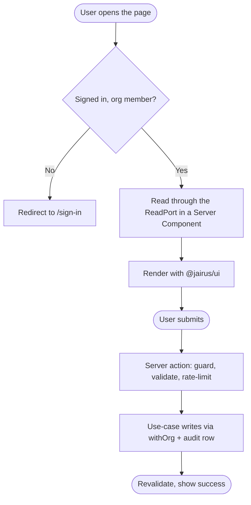
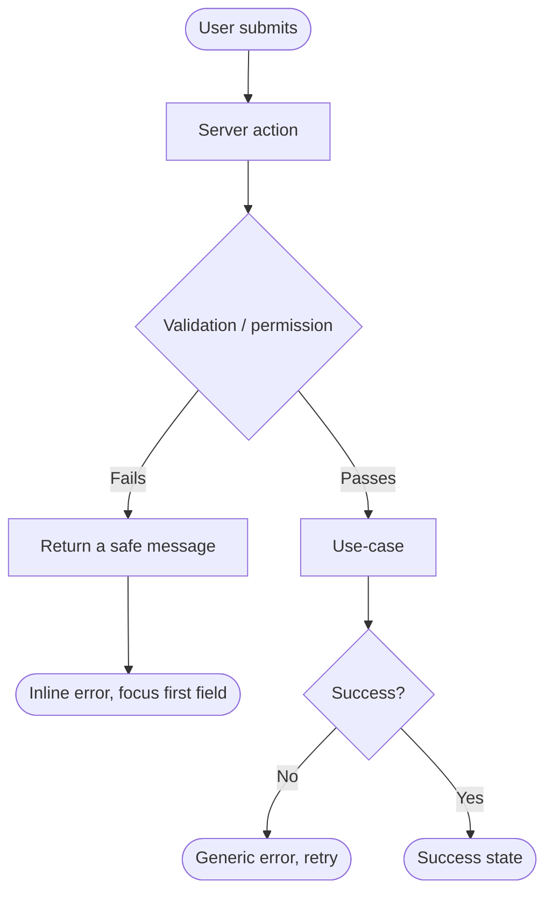

# Technical Design: {{Feature Display Name}}

<!-- NOTE: Complete this after the PRD is approved (Gate 3 needs both). The developer builds exactly
     this design and the spec.json Extension plan. Starter facts and zones: rules/starter-contract.md. The core
     (packages/*) is read only: the feature is a plugin, values go in branding/, screens are thin
     route files in the apps. -->

## 1. Architecture Overview

<!-- NOTE: How does this feature fit the starter? 2–4 sentences, then the list of what is created or
     changed. Name the plugin and the layers it uses (domain, application, repos, manifest). -->

**Plugin:** `plugins/{{plugin}}/` (`@product/plugin-{{plugin}}`) — <!-- new (scaffolded by /jairus:extend) | existing -->

<!-- NOTE: The acceptance criteria, the Extension plan (contribution points and files), the extension
     requests and each entry point's guard and audit live in spec.json: do not restate them here. -->
## 2. User Flows

<!-- NOTE: The key paths through the feature. Mermaid or ASCII. At least the happy path and the
     auth-error path. -->

### Flow 1: Happy path — {{primary user action}}



### Flow 2: Error path — {{error scenario}}



## 3. Component Hierarchy

<!-- NOTE: The JSX tree; mark [S] = Server, [C] = Client (Server by default). Reuse @jairus/ui
     components; a plugin may not import @jairus/ui — only the route files and components in the
     apps do. -->

```
<{{Feature}}Page> [S]          ← route file in the app
  <{{Feature}}List> [S]        ← reads through the ReadPort
  <{{Feature}}Form> [C]        ← @jairus/ui form components
  <EmptyState> [S]
```

## 4. State Management

| State | Location | How it flows |
|-------|----------|--------------|
| <!-- e.g. the list --> | <!-- Server Component --> | <!-- read per request, revalidated after a mutation --> |
| <!-- e.g. form input --> | <!-- Client Component --> | <!-- local until submit --> |

## 5. Error Handling

| Error scenario | What the user sees | Recovery |
|---------------|-------------------|----------|
| Load failure | error boundary fallback | retry |
| Validation error | inline field error | fix input |
| Session expired | redirect to /sign-in | sign in again |
| Feature switched off | "not available" state | none (staff control) |

## 6. Accessibility (a11y)

- **Keyboard navigation**: <!-- tab order, activation, dismissal -->
- **ARIA roles**: <!-- landmarks, dialogs -->
- **Focus management**: <!-- after open/close/submit -->
- **Screen reader**: <!-- live regions, labels -->
- **Colour contrast**: theme tokens only (no raw colours); WCAG AA in light and dark

## 7. Performance

- **Loading**: <!-- Suspense + skeleton; request-time reads inside <Suspense> -->
- **Caching**: <!-- revalidatePath / tags after mutations -->
- **Pagination**: <!-- cursor / offset, or "bounded" -->

## 8. Security

<!-- NOTE: rules/security.md has the full checklist. Call out the feature-specific decisions. -->

- **Authentication / authorization**: <!-- guard per entry point from @/server/guards; org actions or permissions the plugin declares -->
- **Tenancy**: business data only through `withOrg`; every table is org-scoped with RLS enabled and forced
- **Audit**: <!-- each mutation's audit action <id>.<entity>_<verb>, written in the same transaction -->
- **Input validation**: zod schema in the server action before the use-case runs
- **Runtime switch**: <!-- the plugin master switch and any <id>.<name> switch; asked outside transactions -->

---

## Approval

- [ ] Architecture approved — flows and hierarchy make sense (the Extension plan is reviewed in spec.json)
- [ ] Security reviewed — guards, tenancy, audit and validation are sound
- [ ] Accessibility reviewed — the a11y plan is sufficient
- **Date approved**: <!-- YYYY-MM-DD -->
